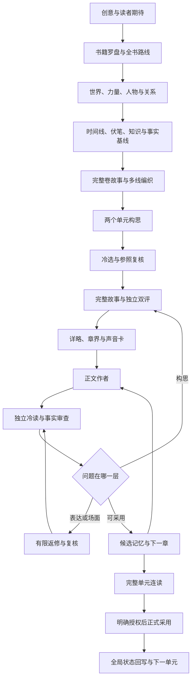

# Novel Forge · 长篇网文多智能体工作流

**先把故事写得值得读，再让多智能体把它持续写下去。**

从创意、全局设定、卷纲到正文，用分工、独立冷读、事实审查和有界返修组织长篇创作。

[English](README.en.md) · [快速开始](docs/quickstart.md) · [36步完整流程](docs/workflow.md) · [八层参照方法](docs/eight-layers.md) · [角色提示词](prompts/README.md)

## 为什么做这个项目

我们在持续迭代中遇到的麻烦，不只是模型偶尔写错：

- 大纲逻辑完整，正文却没有让人想追下去的事。
- 审稿越来越严格，返修把原本有力的回报改成了保守解释。
- 角色逐渐都像顾问，只会提醒风险、确认安排。
- 计划、候选和已发生事实混在一起，越写越难接。
- 流程越来越厚，写作被检查表挤占。

Novel Forge 把这些经验整理成可以检查、修改和复用的方法。核心目标是把读者期待、人物选择和实际兑现贯穿整条链路。

## 核心设计

| 设计 | 做法 |
|---|---|
| 故事先行 | 两个实质不同构思 → 连续完整故事 → 详略与分章 → 正文 |
| 独立冷读 | 读者角色只见正文和必要前情，不用规划替正文补答案 |
| 事实单独审核 | 能力、知识、物件、关系、资源、时空分别核对 |
| 分层返修 | 表达修段落，场面修场面，构思返回故事层 |
| 保留吸引力 | 修漏洞，同时保住成立的选择、优势、回报和情绪体验 |
| 分支记忆 | 已写事实、候选计划、作者真相与读者已见分开 |
| 有界自主 | 在授权与预算内继续工作，保留失败、断点与证据 |

## 流程一览



图中循环受调用和返修预算约束；不是无限生成直到模型说通过。

## 五分钟开始

需要 Python 3.9+；拼装工具仅用标准库，不调用模型、不需要 API key。

```bash
python3 tools/assemble.py --role coordinator --input examples/task.json --output task-prompt.txt
python3 tools/check_release.py
```

把生成的提示词交给你使用的 AI 助手。总控按任务拆分角色；生成正文后，把正文和必要前情交到新的冷读上下文。完整步骤见[快速开始](docs/quickstart.md)。

你也可以直接复制 `prompts/portable/` 中的提示词，用自己的 agent 框架编排。

## 当前能用到什么

- 36步流程与产物契约。
- 8个可手动使用的通用角色提示词。
- 21项历史基线合同，用于理解设计演变。
- 开书任务、全局资产、记忆与评审模板。
- 本地提示词拼装器和发布内容检查器。

**这是方法与提示词工具包，不是安装后自动生成百万字小说的软件。** 历史执行器仍依赖私人书稿、目录与授权状态，未直接搬入公开仓库。通用角色是新整理版本，尚未完成真实长篇效果验证。工程检查通过不等于文学质量通过，更不等于商业成功。

## 参照作品怎样用

学欲望、体验、成立条件、信息顺序与回报实现；为自己的世界、人物和事件重新设计。八层方法不要求复制原作句子、人物、能力或独特事件序列。仓库不包含任何第三方小说全文或私人稿件；参照材料由使用者自行提供。

## 路线图

- [x] 发布方法、提示词与模板
- [x] 提供可离线运行的提示词拼装器
- [ ] 通用执行器：显式来源绑定、调用账、断点与失败恢复
- [ ] 可分享的完整原创样本及失败案例
- [ ] 独立盲读与长期一致性评测
- [ ] 模型适配实验，而非只改默认模型名

欢迎提交实际使用中出现的失败案例、最小复现和修正对照。觉得有用可以点 Star；更有价值的是告诉我们哪一步真的改善了阅读，哪一步只是增加了流程。

[贡献方式](CONTRIBUTING.md) · [设计边界与已知问题](docs/limitations.md) · [MIT License](LICENSE)
