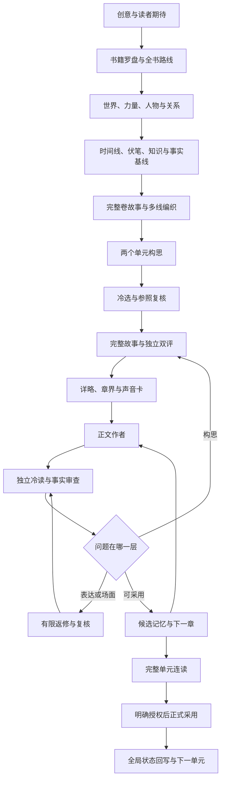

# Novel Forge · 长篇网文多智能体创作系统

**拆透500章以上的长篇，以完整故事单元协作，用三层记忆保持长线，用few-shot设计爽点与自然对白。**

面向真正的长篇生产：从整书结构研究、全局资产和卷纲，到单元写作、独立评审、分层返修与记忆续接。公开方法、提示词、评审标准和关键实现，便于复用与检查。

[English](README.en.md) · [快速开始](docs/quickstart.md) · [完整流程](docs/workflow.md) · [评审标准](standards/README.md) · [实现清单](reference/README.md) · [证据与完整性](docs/evidence-and-completeness.md)

## 我们解决的六个核心问题

### 1. 长篇拆书：超过500章，也能追到全书因果

按来源SHA与章节/行号建立索引，分窗口连续阅读，逐章记录因果、详写与概述、信息释放时机、跨窗未决线索，再整理完整故事单元、铺垫—兑现关系和全书结构。拆的是“作者怎样让故事持续成立”，而不只是情节摘要。

历史记录覆盖1498章、1594章及正文末章题668的三部作品，共269个阅读窗口、约1428万文本字符。章节索引、实际阅读和分析质量分开记录。[拆解结构与覆盖依据](docs/book-analysis.md)

### 2. 单元级协作：一次任务完成一段完整故事

先设计完整单元，再安排详略、章界与正文，最后整单元连读。减少逐章重新规划和反复交接，让欲望、选择、对手回应、中段变化、高潮与余波处在同一条因果链上。

“一次”是单元级任务边界，不是一个模型调用；运行器内部顺序写章，复用已审输入与断点，按证据有界返修。[单元级生产与效率机制](docs/unit-production.md)

### 3. 长期记忆：三层状态 + 原子上下文提取

M1保存批准主线、世界与硬规则；M2保存人物关系、资源、对手、伏笔和当前单元状态；M3保存近期正文、章尾动作和连续性。上下文工具按任务取完整记录，核来源SHA与用途权限，必需事实超预算就报错，不截半条规则继续写。

**作者实际使用验证：已在Dot中用这套系统完成一部300万字长篇，并反馈主线与剧情保持长期稳定。** 这是作者实用结果；公开版尚未附Dot部署日志和独立漂移评测，不把该经验写成所有模型/题材的零漂移保证。[三层记忆、工具与验证边界](docs/memory-and-context.md)

### 4. few-shot爽点设计：让读者期待落到具体所得

用完整故事示范学习欲望、压力、决定性选择、可见回报和持久改变。检索画像与写作payload分开，结合独立故事线、多线编织、复合高潮三种结构，再由本书人物和世界重新设计事件。返修同时检查原本成立的爽点是否被削弱。[剧情few-shot链路](docs/few-shot-systems.md)

### 5. few-shot + 独立检索：针对对话AI味

按场景与交流焦点召回完整窗口，经Canonical去重、ABC排序和Focused Audit，分别判断交流结构与表达表面是否适配，再投递真正可学的能力。解决全员顾问腔、无动机讲课、摘要型对白、名词压缩和机械提醒等问题；不用禁词表或统一短句替代人物动机。

独立检索器及准入/参考降级代码已公开。轻量默认路线使用单书有界窗口，两条路线分开说明，不混称每次都执行同一检索链。[对白检索与诊断](docs/few-shot-systems.md)

### 6. 两套评审标准：故事设计和实际正文分别验收

单元设计看故事是否完整、期待怎样发展、人物和世界是否参与因果、回报与余波是否成立。正文看实际阅读效果、P32/E12/D8、详略、29类表达问题、自然表达双判及跨场对白。

已补齐单元U规则与v5比较规则、正文v7.1方法，以及最新轻量流程的自然容量和修后吸引力保留说明。设计通过不替正文通过，评审结论都绑定范围与原文证据。[完整评审入口](standards/README.md)

## 流程一览



图中循环受调用和返修预算约束；不是无限生成直到模型说通过。

## 五分钟开始

需要 Python 3.10+；拼装工具仅用标准库，不调用模型、不需要 API key。

```bash
python3 tools/assemble.py --role coordinator --input examples/task.json --output task-prompt.txt
python3 tools/check_release.py
```

把生成的提示词交给你使用的 AI 助手。总控按任务拆分角色；生成正文后，把正文和必要前情交到新的冷读上下文。完整步骤见[快速开始](docs/quickstart.md)。

你也可以直接复制 `prompts/portable/` 中的提示词，用自己的 agent 框架编排。

## 当前公开的内容

- 36步流程、八层参照方法与三层记忆架构。
- 8个通用角色提示词、21项历史角色合同。
- 完整单元/正文评审规则与版本说明。
- 拆书、上下文、记忆、单元执行、效率和few-shot检索的关键源码及来源映射。
- 可独立运行的提示词拼装器、原文分段读取器和原子上下文工具。

公开版包含可用方法和离线工具；历史生产源码仍需自有语料、配置与模型客户端。`reference/`明确哪些实现依赖原部署，不把源码归档当成开箱即用的全自动产品。

## 参照作品怎样用

学欲望、体验、成立条件、信息顺序与回报实现；为自己的世界、人物和事件重新设计。八层方法不要求复制原作句子、人物、能力或独特事件序列。仓库不包含任何第三方小说全文或私人稿件；参照材料由使用者自行提供。

## 路线图

- [x] 发布方法、提示词与模板
- [x] 提供可离线运行的提示词拼装器
- [ ] 通用执行器：显式来源绑定、调用账、断点与失败恢复
- [x] 补齐关键系统实现与完整评审标准
- [ ] 可分享的完整原创样本及失败案例
- [ ] 独立盲读与长期一致性评测
- [ ] 模型适配实验，而非只改默认模型名

欢迎提交实际使用中出现的失败案例、最小复现和修正对照。觉得有用可以点 Star；更有价值的是告诉我们哪一步真的改善了阅读，哪一步只是增加了流程。

[贡献方式](CONTRIBUTING.md) · [设计边界与已知问题](docs/limitations.md) · [MIT License](LICENSE)
